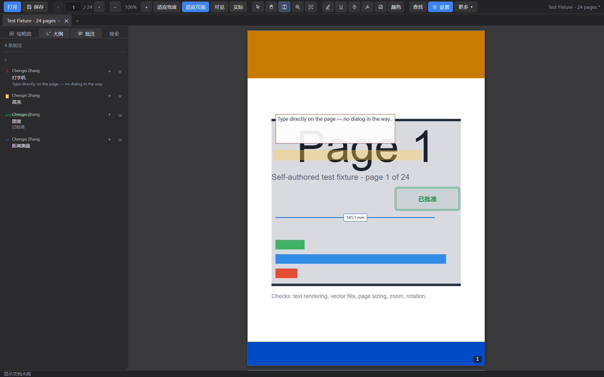

# PDF Looker Pro

**A desktop PDF reader built from scratch: fast continuous scrolling, real annotations, measurement tools and a toolbar you can shape yourself.**

[简体中文](README.zh-CN.md) · English

[](LICENSE)
[](CHANGELOG.md)
[](#download)
[](https://www.electronjs.org/)
[](https://mozilla.github.io/pdf.js/)



---

## What it is

PDF Looker Pro is a desktop PDF reader with an interface written from scratch. It renders
with [pdf.js](https://mozilla.github.io/pdf.js/) and wraps it in an Electron shell — both
permissively licensed — but every piece of the application around them is original code:
the viewer, the annotation engine, the icon set, the bundled font, and the resource
container that packs them.

It began as a reconstruction exercise and grew into a reader that is genuinely pleasant to
use for reading and marking up papers.

## Features

### Reading

- **Continuous, single-page, two-page and full-screen** view modes
- **Virtualised rendering** — only pages near the viewport are drawn, so a 200-page
  document opens as quickly as a two-page one
- **Text layer** with selection and copy
- **Find** with match highlighting (`Ctrl+F`)
- **Zoom** to fit width or page, free zoom, `Ctrl` + wheel
- **Rotate** in 90° steps
- **Actual size** and **fit visible area**, alongside fit width and fit page
- **A magnifier** that follows the pointer, read from the rendered page itself
- **Previous and next view** on `Alt`+`←` / `Alt`+`→`
- **Print** with a page range, scale and orientation (`Ctrl+P`)
- **Outline, thumbnails and an annotation list** in a collapsible sidebar
- **Four themes** — light, dark, sepia and high contrast
- **Chinese and English** throughout, switchable at runtime
- **Multiple documents in tabs**, each keeping its own scroll position and zoom

### Annotating

- **Ten annotation types** — highlight, underline, strikeout, freehand ink, sticky note,
  rectangle, ellipse, arrow, text box and callout
- **Select without switching tools** — clicking an existing annotation selects it under any
  tool, and the toolbar returns to the pointer after you create one
- **Drag to move**, with a visible selection frame and a corner grip
- **Edit text where it lives** — double-click a text box and type in place; there is no
  dialog in the way
- **Boxes that fit their text** — a box made by clicking shrinks to its content, while a
  box you dragged out keeps the size you gave it
- **Adjustable colour, line style, line width and text size**, applied to the selection or
  to the next annotation
- **Style presets** — save the current combination under a name and reuse it
- **Six standard stamps** — approved, confidential, draft, reviewed, void, final —
  written as `/Stamp` with the name other readers recognise
- **Replies**, written as `/IRT` annotations so other readers show the thread
- **A named author** on every annotation, written as `/T`
- **Flatten** annotations into the page, or **summarise** the annotated pages

### Measuring

- **Distance**, **perimeter** and **area**, drawn on the page with the value beside them
- Millimetres, centimetres, inches or points
- Honours each page's `/UserUnit`, so large-format drawings measure correctly

### Everything else

- **Customisable toolbar** — tick a command in the *More* menu and it appears on the bar
- **Annotations are written into the PDF itself** — an incremental update appends to
  the file, so the original bytes are untouched and other readers see the markup
- **Existing PDF annotations are read back** when you open a file that has them
- **Export** the current page as an image, or annotations as JSON or `.arpk`
- **Native menu, recent files and window geometry**, restored between launches

### The document

- **Merge another document** into this one, before any page, with references
  renumbered so the incoming pages keep pointing at their own content
- **A whole-document rewrite** — rebuilds the page tree, copies every object through
  and recomputes the cross-reference, so pages can be deleted, reordered and inserted
- **Delete, rotate, insert, extract, crop and reorder** page ranges, with annotations
  travelling with their pages
- **New blank documents**, and **one-page documents from an image**
- **A search panel** listing every match by page, **folder search** across documents,
  and **saved searches** that re-run in one click

## Download

Grab `PDFLookerPro-portable.exe` from the [latest release](https://github.com/dongfangxy/pdf-looker-pro/releases/latest).
It is a portable build: no installer, no registry entries, just run it.

> ### A note on the download size
>
> The portable build is around **108 MB**. That is almost entirely the Electron runtime,
> not this project — the application's own code and assets come to well under 1 MB.
>
> It is the first release, and shrinking it is the main item on the roadmap. See
> [Release notes for 1.0.0](docs/RELEASE-1.0.0.md) for the specific opportunities; the
> short version is that a lighter packaging path and a trimmed runtime should cut this
> substantially in a future release.

## Getting started

### Requirements

- **Node.js 24+**
- **Windows** for packaging (the app itself is cross-platform Electron code)

### Run from source

```bash
git clone https://github.com/dongfangxy/pdf-looker-pro.git
cd pdf-looker-pro
npm install
npm run fixtures     # generates the test PDFs used by the test suites
npm run dev          # Vite dev server for the renderer
npm run desktop      # Electron shell around the dev server
```

### Build

```bash
npm run build        # type-check and bundle the renderer into dist/
npm run pack         # produce release/PDFLookerPro-portable.exe
```

## Verification

Every feature in this project is verified by running the real application, not by
asserting against mocks. The suites drive a headless browser and the packaged Electron
binary:

```bash
npm test             # all browser suites
npm run test:desktop # the packaged application
```

| Suite | Covers |
| --- | --- |
| `test-container` | the `.arpk` resource container |
| `test-font` | the bundled font |
| `e2e` | rendering, zoom, rotation, text layer |
| `e2e-i18n` | language packs and fallback |
| `e2e-resources` | the packed icons and font |
| `e2e-p5` | annotations |
| `e2e-settings` | settings, themes, wheel zoom |
| `e2e-ux` | toolbar, selection, in-place editing |
| `e2e-tabs` | multi-document tabs |
| `e2e-styles` | style presets |
| `e2e-pdfwrite` | writing annotations into the PDF, verified by reading it back with pdf.js |
| `e2e-pdfroundtrip` | annotate, save, re-open, and find everything intact |
| `e2e-electron` | the packaged desktop shell |
| `e2e-desktop` | native menus, recents, window state |

**409 assertions, 0 failures.**

## Project layout

```
src/
  annotations/   annotation model, layer, sidecar, style presets
  pdf/           PDF object syntax, cross-reference reader, incremental writer, import
  i18n/          language packs and command descriptor registry
  platform/      Electron bridge
  resources/     .arpk container reader
  sidebar/       outline, thumbnails, annotation list
  tabs/          document sessions and the tab strip
  tools/         tool state, measurement geometry and unit conversion
  ui/            dialogs
  viewer/        rendering, virtualisation, zoom, text layer
electron/        main process and preload bridge
tools/           build scripts and the verification suites
docs/            format documentation and design notes
```

## Documentation

- [`docs/format-arpk.md`](docs/format-arpk.md) — the `.arpk` resource container format
- [`docs/design-notes.md`](docs/design-notes.md) — decisions, pitfalls and how bugs were found
- [`docs/RELEASE-1.0.0.md`](docs/RELEASE-1.0.0.md) — 1.0.0 release notes, including the size discussion
- [`docs/PUBLISHING.md`](docs/PUBLISHING.md) — how to cut a release

## Known limitations

Stated plainly, because a reader that hides its gaps is hard to trust:

- **Written annotations are not encrypted.** A PDF that is itself encrypted is
  refused rather than written to, because the security handler is not implemented.
- **Text in a text box is preserved but may render with a substitute font** in other
  readers. The text is stored in full; the box asks for Helvetica, and a viewer that
  cannot find a glyph falls back. This reader always shows it correctly.
- **An incremental update grows the file.** Saving the same document repeatedly
  appends another section each time; a PDF optimiser will compact it again.
- **Windows portable build only.** There is no installer and no signed build.
- **Measurement covers two-point distance and rectangular perimeter/area.** Polyline
  measurement of irregular shapes is not implemented.
- **No forms, digital signatures or OCR.**
- Only the ASCII/Latin and CJK ranges the bundled font covers are guaranteed; the font
  carries no hinting or kerning.

## Contributing

Issues and pull requests are welcome — see [CONTRIBUTING.md](CONTRIBUTING.md). Please run
the verification suites before opening a pull request.

## Licence

[MIT](LICENSE) © Paolu

Third-party components are used under their own licences: [pdf.js](https://mozilla.github.io/pdf.js/)
(Apache-2.0), [Electron](https://www.electronjs.org/) (MIT), [Vite](https://vite.dev/) (MIT)
and [TypeScript](https://www.typescriptlang.org/) (Apache-2.0). No third-party artwork,
fonts or interface strings are included — the icons and the bundled font were produced for
this project.

## Contact

**Paolu** — dongfangxy@163.com · [github.com/dongfangxy](https://github.com/dongfangxy)
